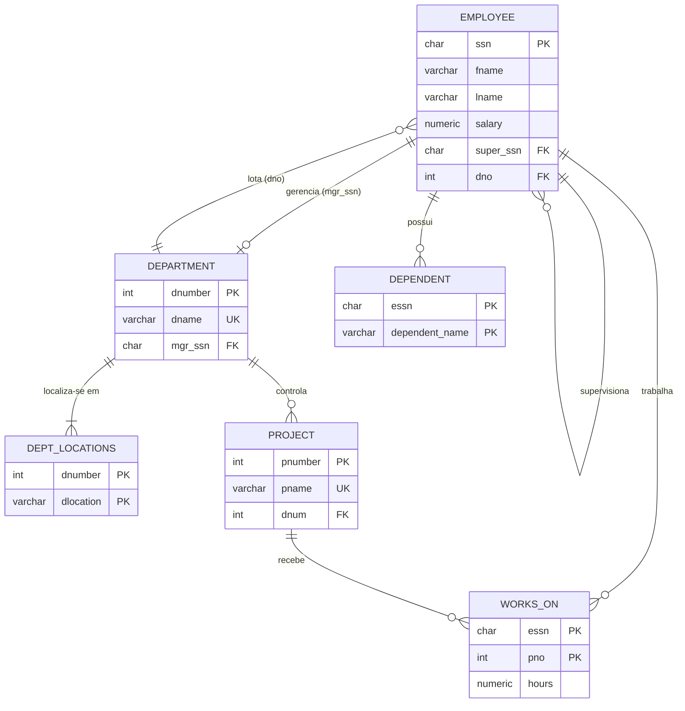
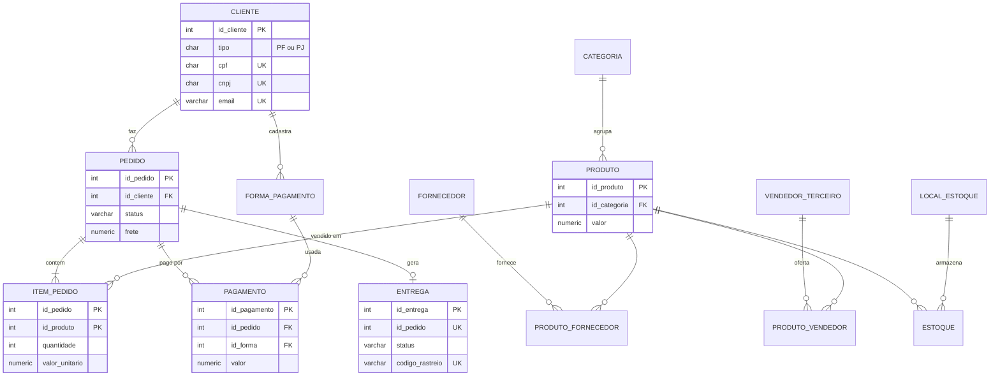

# Personalizando o Banco de Dados com Índices e Procedures

Desafio DIO: personalização dos bancos Company e E-commerce em PostgreSQL, com consultas analíticas, índices justificados por tipo e uso, e procedures em PL/pgSQL com variável de controle para inserir, atualizar, remover e consultar dados.

## Descrição do desafio

O desafio tem duas partes:

1. **Índices**: criar os bancos Company e E-commerce, escrever consultas que respondam perguntas de negócio e criar índices apenas onde eles ajudam essas consultas, justificando o tipo escolhido.
2. **Procedures**: criar uma procedure para cada banco que recebe os dados e uma variável de controle indicando a ação (consultar, inserir, atualizar ou remover).

O curso usa MySQL. Este repositório faz a mesma entrega em PostgreSQL; as diferenças estão na seção [Adaptação MySQL → PostgreSQL](#adaptação-mysql--postgresql).

## Tecnologias

- PostgreSQL 14 ou superior (testado no 16)
- PL/pgSQL
- DBeaver (cliente SQL)

## Estrutura dos arquivos

| Arquivo | Conteúdo |
|---|---|
| `01_company_schema.sql` | Schema `company`: tabelas, chaves e dados de exemplo |
| `02_ecommerce_schema.sql` | Schema `ecommerce`: tabelas, chaves, restrições e dados de exemplo |
| `03_company_queries_indices.sql` | Índices do Company e as três consultas pedidas |
| `04_ecommerce_queries_indices.sql` | EXPLAIN ANALYZE antes/depois, índices do E-commerce e consultas analíticas |
| `05_procedure_company.sql` | Procedure `company.sp_gerenciar_employee` e chamadas de exemplo |
| `06_procedure_ecommerce.sql` | Procedure `ecommerce.sp_gerenciar_cliente` e chamadas de exemplo |

## Ordem de execução

Os dois bancos ficam em schemas separados (`company` e `ecommerce`) dentro do mesmo database. Execute os scripts em ordem:

```text
01 → 02 → 03 → 04 → 05 → 06
```

No DBeaver, abra cada arquivo e use **Execute SQL Script** (Alt+X). As mensagens das procedures (RAISE NOTICE) aparecem na aba **Output**; se ela não estiver visível, ative **Show server output** na barra do editor.

Pelo terminal:

```bash
createdb dio_desafio
for f in 0*.sql; do psql -d dio_desafio -v ON_ERROR_STOP=1 -f "$f"; done
```

Observações:

- Os scripts 01 e 02 recriam o schema do zero (`DROP SCHEMA ... CASCADE`), apagando também índices e procedures. Depois de rodá-los, rode novamente os scripts seguintes.
- Os scripts 03 a 06 podem ser executados mais de uma vez (`IF NOT EXISTS`, `CREATE OR REPLACE`, exemplos que limpam o que inserem).

## Diagramas

### Company



### E-commerce



Principais restrições do E-commerce:

- `chk_cliente_pf_pj`: cliente PF tem CPF e não tem CNPJ; PJ tem CNPJ e não tem CPF.
- CPF, CNPJ, e-mail e código de rastreio são `UNIQUE`.
- Status de pedido, pagamento e entrega são validados por `CHECK`.
- Quantidades e valores não podem ser negativos; data de entrega não pode ser anterior à de envio.
- Um pedido tem no máximo uma entrega (`entrega.id_pedido UNIQUE`) e pode ter vários pagamentos.

## Consultas

**Company** (`03_company_queries_indices.sql`)

- Departamento com maior número de pessoas (usa `RANK()` para não esconder empates)
- Departamentos por cidade (versão detalhada e versão resumida com `STRING_AGG`)
- Relação de empregados por departamento (lista e resumo com folha salarial)

**E-commerce** (`04_ecommerce_queries_indices.sql`)

- Q1: pedidos por cliente, com valor total e ticket médio
- Q2: produtos mais vendidos
- Q3: faturamento por categoria, com participação percentual
- Q4: entregas por status e prazo médio; Q4b: entregas em aberto

## Índices

| Banco | Tabela | Coluna(s) | Tipo | Motivo | Consulta |
|---|---|---|---|---|---|
| Company | `employee` | `dno` | B-tree | FK usada em JOIN e GROUP BY com department | Departamento com mais pessoas; empregados por departamento |
| Company | `dept_locations` | `dlocation, dnumber` | B-tree composto | A PK começa por `dnumber` e não serve para buscar ou ordenar por cidade; o índice cobre a consulta (Index Only Scan) | Departamentos por cidade |
| E-commerce | `pedido` | `id_cliente` | B-tree | FK usada no JOIN cliente → pedido; evita ler a tabela inteira para achar os pedidos de um cliente | Q1 e remoção de cliente na procedure |
| E-commerce | `item_pedido` | `id_produto` | B-tree | FK; a PK começa por `id_pedido` e não atende buscas por produto | Q2 e Q3 |
| E-commerce | `produto` | `id_categoria` | B-tree | FK usada no JOIN produto → categoria | Q3 |
| E-commerce | `entrega` | `status, data_envio` | B-tree parcial (`WHERE status IN ('Aguardando envio', 'Em transporte')`) | `status` tem poucos valores e a maioria das entregas fica "Entregue"; o índice guarda só as entregas em aberto | Q4b |

Critérios usados:

- **Chave estrangeira não tem índice automático no PostgreSQL.** Só PK e UNIQUE ganham índice. Por isso as FKs usadas em JOIN foram indexadas manualmente.
- **Não foram duplicados índices já existentes.** Colunas que são a primeira coluna de uma PK composta (`works_on.essn`, `item_pedido.id_pedido`, `estoque.id_produto`) ou que têm UNIQUE (`cpf`, `email`, `codigo_rastreio`) já estão indexadas.
- **FKs sem consulta que as use ficaram sem índice** (por exemplo `pagamento.id_pedido` e `project.dnum`), e isso está anotado nos scripts como próximos candidatos.
- **B-tree em vez de Hash:** o B-tree atende igualdade, intervalos e ordenação; o Hash atende só igualdade, não aceita índice composto e não traz ganho relevante nesses casos.
- **Q4 (entregas por status) não tem índice próprio:** ela agrega a tabela inteira, e nesse caso o Seq Scan é o plano adequado.

### EXPLAIN ANALYZE antes/depois

No início do `04_ecommerce_queries_indices.sql` há um bloco que, dentro de uma transação, gera 20 mil clientes e 200 mil pedidos, roda `EXPLAIN (ANALYZE, BUFFERS)` da busca de pedidos de um cliente sem índice, cria `idx_pedido_cliente` e repete o EXPLAIN. No final, um `ROLLBACK` desfaz tudo, e as sequências dos IDs são realinhadas. Resultado obtido no teste (PostgreSQL 16):

| | Plano | Tempo |
|---|---|---|
| Sem índice | `Parallel Seq Scan on pedido` (≈200 mil linhas descartadas pelo filtro) | ≈10–17 ms |
| Com índice | `Bitmap Index Scan on idx_pedido_cliente` | ≈0,1–0,3 ms |

Os tempos variam conforme a máquina; o que muda de forma consistente é o tipo de leitura.

## Procedures

| Procedure | Tabela | Arquivo |
|---|---|---|
| `company.sp_gerenciar_employee` | `employee` | `05_procedure_company.sql` |
| `ecommerce.sp_gerenciar_cliente` | `cliente` | `06_procedure_ecommerce.sql` |

O primeiro parâmetro, `p_acao`, é a variável de controle:

| `p_acao` | Ação | Comportamento |
|---|---|---|
| 1 | Consultar | Lista os registros (com filtros opcionais) via `RAISE NOTICE` |
| 2 | Inserir | Valida os campos obrigatórios e insere |
| 3 | Atualizar | Altera apenas os campos informados; os demais mantêm o valor atual (`COALESCE`) |
| 4 | Remover | Remove pelo identificador |

A ação é escolhida com `CASE`. Valores fora de 1–4 geram mensagem de ação inválida.

Os demais parâmetros têm `DEFAULT NULL`, então a chamada usa notação nomeada e informa só o necessário:

```sql
CALL company.sp_gerenciar_employee(1, p_dno => 5);
CALL company.sp_gerenciar_employee(3, p_ssn => '555666777', p_salary => 34500);
CALL ecommerce.sp_gerenciar_cliente(2, p_tipo => 'PF', p_nome => 'Helena Castro Viana',
                                    p_cpf => '999.888.777-66', p_email => 'helena@email.com');
```

**Tratamento de erros.** Cada procedure tem um bloco `EXCEPTION` que captura violações de PK/UNIQUE, FK, CHECK, NOT NULL e tamanho de campo, além das validações feitas pela própria procedure. Em vez de interromper o script, a mensagem é exibida com `RAISE NOTICE`, por exemplo:

```text
NOTICE:  Erro: o empregado 333445555 é gerente de um departamento. Troque o gerente antes de removê-lo.
NOTICE:  Erro: o cliente 1 possui pedidos e não pode ser removido. Mantenha o cadastro para preservar o histórico.
```

Quando o erro é capturado, o PostgreSQL desfaz o que foi feito dentro do bloco, então não fica alteração pela metade.

Regras específicas da procedure de cliente: CPF e CNPJ podem vir com máscara (só os dígitos são gravados), o documento que não corresponde ao tipo é descartado, e a troca de PF para PJ exige o novo documento.

## Adaptação MySQL → PostgreSQL

| Tema | MySQL (curso) | PostgreSQL (este repositório) |
|---|---|---|
| Delimitador | `DELIMITER $$ ... END $$ DELIMITER ;` para o cliente não cortar o corpo no primeiro `;` | Não existe `DELIMITER`. O corpo da procedure fica entre `$$ ... $$` (dollar quoting) |
| Linguagem | SQL/PSM do MySQL | `LANGUAGE plpgsql` |
| Retorno de SELECT em procedure | Um `SELECT` dentro da procedure devolve o resultado ao cliente | Procedure não devolve linhas; um `SELECT` sem destino gera erro. Aqui a consulta usa `FOR ... LOOP` + `RAISE NOTICE`. Alternativas: `FUNCTION ... RETURNS TABLE` ou parâmetro `INOUT refcursor` |
| Índice em chave estrangeira | O InnoDB cria índice automaticamente na coluna da FK | Não cria. Índices em colunas de FK usadas em JOIN são criados manualmente |
| Chamada | `CALL proc(1, 'a', 'b');` (só parâmetros posicionais) | `CALL proc(1, p_nome => 'a');` aceita parâmetros nomeados e valores `DEFAULT` |
| Tratamento de erro | `DECLARE ... HANDLER FOR SQLEXCEPTION` | Bloco `EXCEPTION WHEN unique_violation THEN ...` com condições nomeadas e `GET STACKED DIAGNOSTICS` |
| Mensagens | `SELECT 'mensagem';` ou `SIGNAL SQLSTATE` | `RAISE NOTICE` (informativa) e `RAISE EXCEPTION` (erro) |
| Auto incremento | `AUTO_INCREMENT` | `GENERATED BY DEFAULT AS IDENTITY` |
| Bancos | `CREATE DATABASE company;` e `USE company;` | Um database com dois schemas (`company`, `ecommerce`) e `SET search_path` |
| Tipos de índice | B-tree, Hash (só em MEMORY), FULLTEXT | B-tree, Hash, GIN, GiST, BRIN, além de índices parciais e de expressão |
